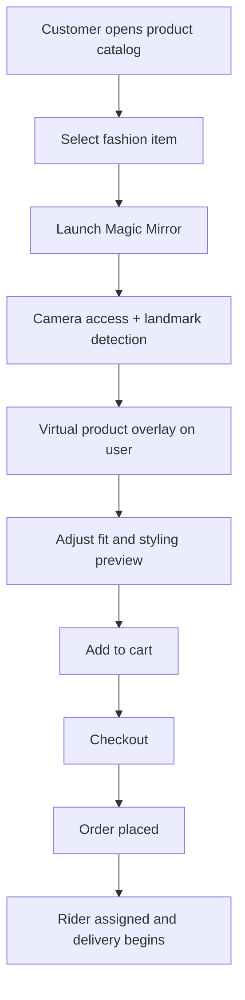

# SWIFTORA
### Smart Fashion. Instant Delivery. Virtual Try-On.

SWIFTORA is designed to solve a common problem in online fashion shopping: customers often have to rely on static product images and descriptions before buying, which creates uncertainty around fit, styling, and confidence. The platform brings together a modern fashion shopping experience with rapid fulfillment and a future-facing virtual try-on layer.

The current repository is a working rider + live-tracking prototype that demonstrates the delivery and fulfillment backbone of the broader SWIFTORA vision. The core innovation, however, is the concept of a Magic Mirror experience that transforms shopping from simply viewing products to virtually experiencing them before purchase.

> SWIFTORA transforms fashion shopping from simply viewing products to virtually experiencing them before purchase through its Magic Mirror experience.

## 🚀 Key Features

| Feature | Description |
| --- | --- |
| 🪞 Magic Mirror | Virtual try-on experience using the device camera; planned as the primary innovation for the next phase of the product. |
| 👗 Smart Fashion Marketplace | Browse fashion products and product collections in a commerce-first interface. |
| 🛒 Smart Cart & Checkout | Add items to cart, manage quantity, and complete a purchase flow. |
| 📦 Real-Time Order Tracking | Monitor order status from placement through fulfillment and delivery. |
| 🛵 Rider Application | Full rider workflow for order assignment, pickup, navigation, and delivery updates. |
| 🖥️ Admin Dashboard | Product, inventory, rider, and order oversight for operational control. |
| 📊 Inventory Management | Track available stock and merchandise readiness. |
| 📍 Live Delivery Tracking | Follow rider movement and status changes in near real time. |

## 🏆 Novelty — Magic Mirror

Magic Mirror is the most important differentiator in the SWIFTORA concept. It is not presented as a minor feature; it is the unique layer that connects fashion commerce with interactive, camera-based product preview.

### ✨ Try Before You Buy
Users can preview selected fashion products or accessories before purchasing instead of relying only on static catalog images.

### 🪞 Interactive Shopping
Instead of passively viewing a product, the user engages with it through a live camera preview and virtual overlay experience.

### 🎯 Reduced Purchase Uncertainty
The virtual preview helps users understand how a product may look on them before committing to a purchase.

### 🤖 Fashion + Computer Vision
SWIFTORA combines fashion commerce with browser-based camera landmark detection and virtual product overlay to make the shopping journey more interactive.

### 👤 Personalized Experience
The user experience becomes more personalized and confidence-driven, especially for fashion categories where fit and appearance matter.

### 🛒 Integrated Commerce
Once a product is virtually previewed, the customer can proceed to selection and checkout without breaking the shopping flow.

### 🚀 Key Differentiator
While traditional fashion e-commerce platforms mostly rely on product images and descriptions, SWIFTORA introduces Magic Mirror as an interactive virtual try-on layer directly inside the shopping journey.

> **SWIFTORA's core novelty is Magic Mirror — transforming fashion shopping from simply viewing products to virtually experiencing them before purchase.**

## 🪞 Magic Mirror Flow



## 🧭 Platform Vision

SWIFTORA is conceived as a connected ecosystem with three core interfaces:

1. Customer App
   - Browse and search fashion products
   - View product details
   - Add to cart and complete purchase
   - Track orders and review history
   - Access Magic Mirror try-on experience

2. Rider App
   - Dashboard and order overview
   - Accept and process assigned deliveries
   - Pickup and route navigation
   - Update delivery status
   - Live rider tracking and earnings summary

3. Admin Dashboard
   - Product and inventory management
   - Order oversight and assignment
   - Rider management
   - Delivery monitoring and operational insights

## 🧩 Current Implementation Status

This repository currently contains the working rider-side delivery application and live tracking demo. The broader SWIFTORA commerce, admin, and Magic Mirror workflows are part of the product vision and are planned for the next implementation phase.

### Implemented in this repo
- Rider dashboard
- Order acceptance and status flow
- Navigation and route preview
- Customer tracking page
- Order history and earnings summary
- Browser-local data persistence for demo purposes
- Google Maps route integration when a key is configured

### Planned / Future Scope
- Fashion marketplace experience
- Product catalog and filters
- Cart and checkout flow
- Admin dashboard
- Inventory and stock management
- Rider assignment logic
- Magic Mirror / browser camera experience
- Supabase-backed real data layer
- MediaPipe-based camera processing
- Vercel deployment pipeline

## 🏗️ System Flow


## 🧪 Demo Flow

```text
User opens app
  ↓
Browse products / categories
  ↓
Open Magic Mirror preview
  ↓
Try item on camera
  ↓
Add to cart and checkout
  ↓
Rider accepts delivery
  ↓
Status updates and customer tracking
```

## 🛠️ Tech Stack

### Current implementation in this repo

| Category | Stack |
| --- | --- |
| Frontend | React, TypeScript, Vite |
| Routing | React Router |
| Styling | CSS |
| UI Icons | Lucide React |
| Maps | Google Maps JavaScript API |
| Storage | localStorage |
| Delivery flow | Browser-based demo state management |

### Planned for the full SWIFTORA product

| Category | Planned Stack |
| --- | --- |
| Frontend UI | Tailwind CSS |
| Backend & data | Supabase |
| AI / camera vision | MediaPipe, browser camera processing |
| Deployment | Vercel |
| GitHub workflow | GitHub |

## 📁 Project Structure

```text
.
├── .env.example
├── README.md
├── index.html
├── package.json
├── package-lock.json
├── public/
├── src/
│   ├── App.tsx
│   ├── components/
│   │   └── shared/
│   │       ├── EarningsChart.tsx
│   │       ├── MapView.tsx
│   │       ├── NextAction.tsx
│   │       ├── OfferActions.tsx
│   │       ├── OnlineToggle.tsx
│   │       ├── OrderCard.tsx
│   │       ├── StatusBadge.tsx
│   │       └── Stepper.tsx
│   ├── hooks/
│   │   └── useLive.ts
│   ├── index.css
│   ├── layouts/
│   │   └── RiderLayout.tsx
│   ├── lib/
│   │   └── format.ts
│   ├── main.tsx
│   ├── pages/
│   │   ├── customer/
│   │   │   └── Tracking.tsx
│   │   └── rider/
│   │       ├── Dashboard.tsx
│   │       ├── Earnings.tsx
│   │       ├── History.tsx
│   │       ├── Navigation.tsx
│   │       └── Orders.tsx
│   ├── services/
│   │   ├── db.ts
│   │   ├── orders.ts
│   │   └── tracking.ts
│   └── types/
│       └── index.ts
├── tsconfig.json
├── vite.config.ts
├── .gitignore
└── .env.example
```

## 🧭 Application Routes

| Route | Purpose |
| --- | --- |
| `/` | Redirects to the rider dashboard |
| `/rider` | Dashboard overview |
| `/rider/orders` | Active delivery and available offers |
| `/rider/navigation` | Route planning and live status tracking |
| `/rider/history` | Past delivery history |
| `/rider/earnings` | Summary of rider payout and performance |
| `/track/:orderId` | Public customer tracking page |

## 🚀 Getting Started

### Prerequisites
- Node.js LTS
- Git
- VS Code

### Install
```bash
git clone https://github.com/ninjaaaa18/CodeStrom_Cypher.git
cd CodeStrom_Cypher
npm install
```

### Run locally
```bash
npm run dev
```
Then open the local Vite URL, usually `http://localhost:5173`.

### Google Maps setup
The app can run without a Google Maps key, but live map routing is enabled when a valid key is configured.

```bash
cp .env.example .env
```
Then add:

```env
VITE_GOOGLE_MAPS_API_KEY=your_api_key_here
```

## 📜 Available Scripts

| Command | Purpose |
| --- | --- |
| `npm run dev` | Run the development server |
| `npm run build` | Create a production build |
| `npm run preview` | Preview the production build locally |
| `npm run typecheck` | Run TypeScript checks |

## 🔒 Privacy and Camera Notes

The current implementation does not include a production camera-based virtual try-on pipeline. This repository uses browser geolocation for delivery tracking demos and includes a route simulation flow for presentation purposes. Any camera-based Magic Mirror functionality would be implemented as a separate layer and should be designed carefully with explicit browser permission handling and clear user consent.

## ⚠️ Current Limitations

- This is a hackathon-style prototype with demo data and browser-local persistence.
- The broader fashion commerce workflow is not yet fully implemented in this repository.
- Magic Mirror is part of the product vision, not a shipped production feature in the current codebase.
- Admin, customer commerce, and full backend logic are planned for future iterations.

## 🌱 Future Scope

- AI-powered fashion recommendations
- Advanced virtual try-on and product fit estimation
- Complete customer storefront with product search and filters
- Secure authentication and user roles
- Payment and checkout integration
- Supabase-backed inventory and order data
- Real-time fleet and rider assignment management
- Production deployment on Vercel

## 🏅 Hackathon Value

SWIFTORA combines three important ideas in one experience: modern fashion commerce, rapid fulfillment, and an interactive virtual try-on concept. The project is valuable because it connects product discovery with customer confidence and operational speed, while also showing a believable rider-delivery workflow that can be expanded into a full commerce platform.

## 👥 Team

CodeStorm
Team Members:
-Sriniranjan
-Ponnanna O B
-Hema S 
-Shivani S

## 🔗 Repository

https://github.com/ninjaaaa18/CodeStrom_Cypher

## Closing

SWIFTORA
Discover. Visualize. Choose.
Experience Fashion Before You Buy.

